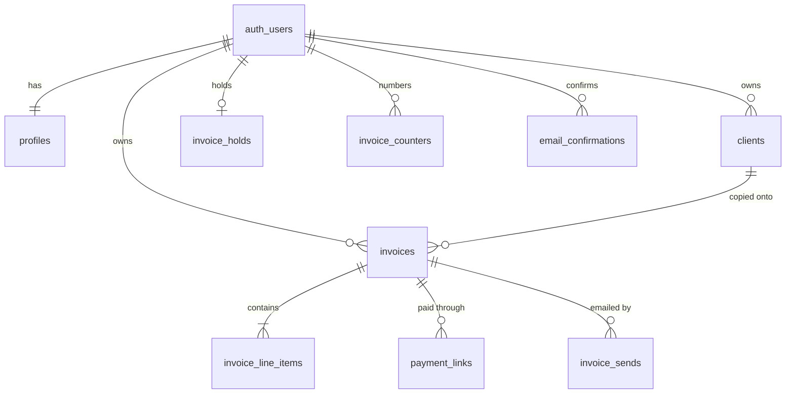

# Invoice Generator — Database schema

Postgres on Supabase. Product rules are in [PRD.md](./PRD.md). How the app uses this schema is in [Tech.md](./Tech.md).

## Conventions

- Identifiers are lowercase `snake_case`.
- Primary keys on application tables are `bigint generated always as identity`. This is one database, so sequential ids stay compact and locality-friendly.
- `profiles.id` is `uuid` because it is `auth.users.id`.
- Money, quantity, and VAT use `numeric`. Timestamps use `timestamptz`. Strings use `text`.
- Status and currency values use `text` plus a check constraint.
- Every table in `public` has Row Level Security enabled. Policies target `authenticated` and compare `(select auth.uid())` so the id is evaluated once per query.
- Foreign keys are indexed.
- A user id on a child row matches the parent through a composite foreign key, so a client or line cannot be attached across users.
- `anon` has no grants on these tables. `authenticated` gets only the actions a policy allows. The Stripe webhook uses the secret key, which bypasses RLS.

Overdue is not a column. A list filters it with `status = 'not_paid' and due_date < current_date`.

## Relationships



## Tables

### `profiles`

One row per auth user, created by trigger on sign-up.

| Column | Type | Notes |
|---|---|---|
| `id` | `uuid` pk | References `auth.users(id)` on delete cascade |
| `full_name` | `text` | |
| `company_name` | `text` | Create requires this or `full_name` |
| `email` | `text` | Reply-To when present |
| `address` | `text` | |
| `vat_id` | `text` | |
| `website` | `text` | |
| `email_confirmed_at` | `timestamptz` | Empty until the app confirmation link is used |
| `stripe_account_id` | `text` unique | Connect account id |
| `stripe_charges_enabled` | `boolean` | Default false. Create sends only when true |
| `created_at` | `timestamptz` | |
| `updated_at` | `timestamptz` | |

### `clients`

| Column | Type | Notes |
|---|---|---|
| `id` | `bigint` identity pk | |
| `user_id` | `uuid` | Owner |
| `full_name` | `text` | |
| `company_name` | `text` | |
| `email` | `text` | Required by the app before the client can be invoiced |
| `address` | `text` | |
| `vat_id` | `text` | |
| `archived_at` | `timestamptz` | Empty means active. Archive sets it. Restore clears it |
| `created_at` | `timestamptz` | |
| `updated_at` | `timestamptz` | |

There is no delete policy. The picker reads rows where `archived_at` is null and `email` is not null. Unique `(id, user_id)` supports the composite foreign key from invoices.

### `invoice_counters`

One row per user per calendar year. The year is the invoice date's year. `authenticated` has no grants on this table. Only `private.next_invoice_number` updates it.

| Column | Type | Notes |
|---|---|---|
| `user_id` | `uuid` | |
| `year` | `integer` | |
| `last_number` | `integer` | Last allocated sequence value |

Primary key `(user_id, year)`.

### `invoices`

The From and To columns are the copy taken at creation. They are what the PDF and the detail screen render.

| Column | Type | Notes |
|---|---|---|
| `id` | `bigint` identity pk | |
| `user_id` | `uuid` | Owner |
| `client_id` | `bigint` | Source client. Remains set after the client is archived |
| `invoice_number` | `text` | `INV-2026-001`. Immutable |
| `invoice_date` | `date` | |
| `due_date` | `date` | Must be on or after `invoice_date` |
| `currency` | `text` | `EUR`, `USD`, or `GBP` |
| `status` | `text` | `not_paid` or `paid`. Default `not_paid` |
| `paid_via` | `text` | `stripe` or `manual`. Empty while unpaid |
| `paid_at` | `timestamptz` | Empty while unpaid |
| `comments` | `text` | Printed in the footer |
| `from_full_name` | `text` | Snapshot |
| `from_company_name` | `text` | Snapshot. At least one of the two From names is required |
| `from_email` | `text` | Snapshot |
| `from_address` | `text` | Snapshot |
| `from_vat_id` | `text` | Snapshot |
| `from_website` | `text` | Snapshot |
| `to_full_name` | `text` | Snapshot |
| `to_company_name` | `text` | Snapshot |
| `to_email` | `text` | Snapshot. Required |
| `to_address` | `text` | Snapshot |
| `to_vat_id` | `text` | Snapshot |
| `subtotal` | `numeric(12,2)` | Sum of line amounts |
| `tax` | `numeric(12,2)` | Sum of line tax |
| `total` | `numeric(12,2)` | Greater than zero |
| `pdf_path` | `text` | Object path inside the `invoices` bucket |
| `send_status` | `text` | `sent` or `failed` |
| `send_error` | `text` | Last failure message |
| `last_sent_at` | `timestamptz` | |
| `created_at` | `timestamptz` | |
| `updated_at` | `timestamptz` | |

Unique `(user_id, invoice_number)`. Unique `(id, user_id)` for composite children.

Paid rows satisfy `paid_via` in (`stripe`, `manual`) and `paid_at` is set. Unpaid rows have both empty.

### `invoice_line_items`

| Column | Type | Notes |
|---|---|---|
| `id` | `bigint` identity pk | |
| `invoice_id` | `bigint` | |
| `user_id` | `uuid` | Same owner as the invoice |
| `position` | `integer` | Display order, unique per invoice |
| `description` | `text` | Required |
| `quantity` | `numeric(10,2)` | Greater than zero |
| `unit` | `text` | `hours`, `days`, `pieces`, or `flat` |
| `unit_price` | `numeric(12,2)` | Zero or greater |
| `vat_rate` | `numeric(5,2)` | From 0 through 100 |
| `line_subtotal` | `numeric(12,2)` | `round(quantity * unit_price, 2)` |
| `line_tax` | `numeric(12,2)` | `round(line_subtotal * vat_rate / 100, 2)` |
| `line_total` | `numeric(12,2)` | `line_subtotal + line_tax` |

A before-insert/update trigger overwrites the three computed columns. The client cannot store a mismatched line total.

### `payment_links`

An invoice has many historical links and one active link.

| Column | Type | Notes |
|---|---|---|
| `id` | `bigint` identity pk | |
| `invoice_id` | `bigint` | |
| `user_id` | `uuid` | |
| `stripe_checkout_session_id` | `text` unique | |
| `url` | `text` | Client payment URL |
| `amount` | `numeric(12,2)` | Invoice total at the time the link was created |
| `currency` | `text` | |
| `active` | `boolean` | Default true |
| `deactivated_at` | `timestamptz` | |
| `created_at` | `timestamptz` | |

Partial unique index on `invoice_id` where `active`.

### `invoice_sends`

One row per send attempt, including the first send, a retry, and a resend.

| Column | Type | Notes |
|---|---|---|
| `id` | `bigint` identity pk | |
| `invoice_id` | `bigint` | |
| `user_id` | `uuid` | |
| `note` | `text` | Optional personal note for this attempt |
| `status` | `text` | `sent` or `failed` |
| `resend_email_id` | `text` | Present when Resend accepted it |
| `error` | `text` | |
| `created_at` | `timestamptz` | |

### `invoice_holds`

At most one unfinished submission per user, used while Stripe onboarding is in progress. This is not an invoice and does not consume a number.

| Column | Type | Notes |
|---|---|---|
| `user_id` | `uuid` pk | |
| `payload` | `jsonb` | Dates, currency, `client_id`, comments, note, and lines |
| `created_at` | `timestamptz` | |
| `updated_at` | `timestamptz` | |

The payload is replaced on the next submit. It is deleted once `create_invoice` succeeds. From and To are not stored here. They are read from the profile and the client when the invoice is created.

### `email_confirmations`

| Column | Type | Notes |
|---|---|---|
| `id` | `bigint` identity pk | |
| `user_id` | `uuid` | |
| `token_hash` | `text` unique | The raw token exists only in the email |
| `expires_at` | `timestamptz` | |
| `used_at` | `timestamptz` | |
| `created_at` | `timestamptz` | |

No policies for `authenticated`. Issue and consume go through security-definer functions.

### `stripe_events`

| Column | Type | Notes |
|---|---|---|
| `id` | `text` pk | Stripe event id |
| `event_type` | `text` | |
| `received_at` | `timestamptz` | |

No policies. The webhook inserts with the secret key. A primary-key conflict means the event was already handled.

## Indexes

- `clients (user_id)` and partial `clients (user_id) where archived_at is null`
- `invoices (user_id, created_at desc)`
- `invoices (user_id, status, due_date)`
- `invoice_line_items (invoice_id)`
- `payment_links (invoice_id)` plus the partial unique active index
- `invoice_sends (invoice_id, created_at desc)`
- `email_confirmations (user_id)`

Foreign-key columns are covered by these indexes or by a primary key.

## Access

| Table | `authenticated` |
|---|---|
| `profiles` | Select and update its own row. Insert is the sign-up trigger |
| `clients` | Select, insert, update its own rows. No delete |
| `invoices` | Select, update, delete its own unpaid rows. Insert is `create_invoice` only |
| `invoice_line_items` | Select, insert, update, and delete its own rows. A trigger rejects changes while the invoice is paid |
| `payment_links` | Select, insert, and update its own rows |
| `invoice_sends` | Select and insert its own rows |
| `invoice_holds` | Select, insert, update, delete its own row |
| `invoice_counters` | None |
| `email_confirmations` | None |
| `stripe_events` | None |

Update policies include both `using` and `with check`, each requiring `(select auth.uid()) = user_id`, so a row cannot be reassigned to another user.

Delete on `invoices` requires `status = 'not_paid'`.

Line-item changes and invoice content changes are rejected by trigger when `paid_via = 'stripe'`. When `paid_via = 'manual'`, the only allowed invoice update clears `status`, `paid_via`, and `paid_at` back to unpaid. Line edits stay closed until that update has committed.

`invoice_number`, `user_id`, and the snapshot columns are unchanged by a normal edit. Changing the selected client is an explicit update of `client_id` and the To snapshot together, done by the server action.

## Functions and triggers

`private.set_updated_at` runs before update on `profiles`, `clients`, `invoices`, and `invoice_holds`.

`private.handle_new_user` is security definer, `search_path` empty, and is only used as an after-insert trigger on `auth.users`. It inserts `profiles (id)`.

`private.next_invoice_number(p_user_id uuid, p_year integer) returns text` is security definer, `search_path` empty. It rejects a `p_user_id` that is not `auth.uid()`. It upserts `invoice_counters` for that user and year, increments `last_number`, and returns `INV-{year}-{number}` padded to three digits. `execute` is revoked from `public`, `anon`, and `authenticated`. `create_invoice` is the only caller.

`public.create_invoice(...)` is security definer, `search_path` empty, and `execute` is granted to `authenticated` only. It:

1. Reads the user from `auth.uid()` and ignores any user id in the arguments.
2. Copies the caller's profile and the selected client after checking both belong to that user, the profile has a full name or a company name, and the client has an email.
3. Allocates the number for `extract(year from invoice_date)`.
4. Inserts the invoice and its lines.
5. Lets the line trigger compute line totals, then sets `subtotal`, `tax`, and `total` from those lines.
6. Raises if the total is not greater than zero, or if the due date is before the invoice date.

Because the number update and the insert share this transaction, a failure rolls both back.

`private.recalculate_invoice_totals` runs when lines change and rewrites the parent totals.

`private.lock_paid_invoice` runs before update and delete on invoices, and before line changes. Stripe-paid rows are left as they are. The transition from unpaid to Stripe-paid is allowed, which is the webhook write. A later update is rejected.

`public.confirm_email(p_token text)` hashes the token, checks the unused unexpired row for `auth.uid()`, sets `used_at`, and sets `profiles.email_confirmed_at`. Security definer, `search_path` empty, granted to `authenticated` only.

## Storage

One private bucket, `invoices`.

Object name: `{user_id}/{invoice_id}.pdf`.

Policies on `storage.objects` let `authenticated` select, insert, and update objects in that bucket whose first path folder equals `auth.uid()`. Delete is allowed for the same folder so removing an unpaid invoice can remove its PDF. The bucket has no public read.

## Schema

```sql
create schema if not exists private;

create table public.profiles (
  id uuid primary key references auth.users (id) on delete cascade,
  full_name text,
  company_name text,
  email text,
  address text,
  vat_id text,
  website text,
  email_confirmed_at timestamptz,
  stripe_account_id text unique,
  stripe_charges_enabled boolean not null default false,
  created_at timestamptz not null default now(),
  updated_at timestamptz not null default now()
);

create table public.clients (
  id bigint generated always as identity primary key,
  user_id uuid not null references auth.users (id) on delete cascade,
  full_name text,
  company_name text,
  email text,
  address text,
  vat_id text,
  archived_at timestamptz,
  created_at timestamptz not null default now(),
  updated_at timestamptz not null default now(),
  unique (id, user_id)
);

create index clients_user_id_idx on public.clients (user_id);
create index clients_active_user_id_idx
  on public.clients (user_id)
  where archived_at is null;

create table public.invoice_counters (
  user_id uuid not null references auth.users (id) on delete cascade,
  year integer not null,
  last_number integer not null,
  primary key (user_id, year),
  constraint invoice_counters_last_number_positive check (last_number > 0)
);

create table public.invoices (
  id bigint generated always as identity primary key,
  user_id uuid not null references auth.users (id) on delete cascade,
  client_id bigint not null,
  invoice_number text not null,
  invoice_date date not null,
  due_date date not null,
  currency text not null,
  status text not null default 'not_paid',
  paid_via text,
  paid_at timestamptz,
  comments text,
  from_full_name text,
  from_company_name text,
  from_email text,
  from_address text,
  from_vat_id text,
  from_website text,
  to_full_name text,
  to_company_name text,
  to_email text not null,
  to_address text,
  to_vat_id text,
  subtotal numeric(12,2) not null,
  tax numeric(12,2) not null,
  total numeric(12,2) not null,
  pdf_path text,
  send_status text,
  send_error text,
  last_sent_at timestamptz,
  created_at timestamptz not null default now(),
  updated_at timestamptz not null default now(),
  unique (user_id, invoice_number),
  unique (id, user_id),
  foreign key (client_id, user_id) references public.clients (id, user_id),
  constraint invoices_currency_known check (currency in ('EUR', 'USD', 'GBP')),
  constraint invoices_status_known check (status in ('not_paid', 'paid')),
  constraint invoices_paid_via_known check (
    paid_via is null or paid_via in ('stripe', 'manual')
  ),
  constraint invoices_send_status_known check (
    send_status is null or send_status in ('sent', 'failed')
  ),
  constraint invoices_due_on_or_after_issue check (due_date >= invoice_date),
  constraint invoices_total_positive check (total > 0),
  constraint invoices_sender_snapshot check (
    char_length(btrim(coalesce(from_full_name, ''))) > 0
    or char_length(btrim(coalesce(from_company_name, ''))) > 0
  ),
  constraint invoices_payment_state check (
    (
      status = 'not_paid'
      and paid_via is null
      and paid_at is null
    )
    or (
      status = 'paid'
      and paid_via in ('stripe', 'manual')
      and paid_at is not null
    )
  )
);

create index invoices_user_created_idx
  on public.invoices (user_id, created_at desc);
create index invoices_user_status_due_idx
  on public.invoices (user_id, status, due_date);
create index invoices_client_id_idx on public.invoices (client_id);

create table public.invoice_line_items (
  id bigint generated always as identity primary key,
  invoice_id bigint not null,
  user_id uuid not null,
  position integer not null,
  description text not null,
  quantity numeric(10,2) not null,
  unit text not null,
  unit_price numeric(12,2) not null,
  vat_rate numeric(5,2) not null,
  line_subtotal numeric(12,2) not null,
  line_tax numeric(12,2) not null,
  line_total numeric(12,2) not null,
  unique (invoice_id, position),
  foreign key (invoice_id, user_id)
    references public.invoices (id, user_id) on delete cascade,
  constraint invoice_line_items_quantity_positive check (quantity > 0),
  constraint invoice_line_items_price_nonnegative check (unit_price >= 0),
  constraint invoice_line_items_vat_range check (vat_rate >= 0 and vat_rate <= 100),
  constraint invoice_line_items_unit_known check (
    unit in ('hours', 'days', 'pieces', 'flat')
  ),
  constraint invoice_line_items_description_present check (
    char_length(btrim(description)) > 0
  )
);

create index invoice_line_items_invoice_id_idx
  on public.invoice_line_items (invoice_id);

create table public.payment_links (
  id bigint generated always as identity primary key,
  invoice_id bigint not null,
  user_id uuid not null,
  stripe_checkout_session_id text not null unique,
  url text not null,
  amount numeric(12,2) not null,
  currency text not null,
  active boolean not null default true,
  deactivated_at timestamptz,
  created_at timestamptz not null default now(),
  foreign key (invoice_id, user_id)
    references public.invoices (id, user_id) on delete cascade,
  constraint payment_links_currency_known check (currency in ('EUR', 'USD', 'GBP')),
  constraint payment_links_amount_positive check (amount > 0),
  constraint payment_links_active_state check (
    (active and deactivated_at is null)
    or (not active and deactivated_at is not null)
  )
);

create index payment_links_invoice_id_idx on public.payment_links (invoice_id);
create unique index payment_links_one_active_idx
  on public.payment_links (invoice_id)
  where active;

create table public.invoice_sends (
  id bigint generated always as identity primary key,
  invoice_id bigint not null,
  user_id uuid not null,
  note text,
  status text not null,
  resend_email_id text,
  error text,
  created_at timestamptz not null default now(),
  foreign key (invoice_id, user_id)
    references public.invoices (id, user_id) on delete cascade,
  constraint invoice_sends_status_known check (status in ('sent', 'failed'))
);

create index invoice_sends_invoice_id_created_idx
  on public.invoice_sends (invoice_id, created_at desc);

create table public.invoice_holds (
  user_id uuid primary key references auth.users (id) on delete cascade,
  payload jsonb not null,
  created_at timestamptz not null default now(),
  updated_at timestamptz not null default now()
);

create table public.email_confirmations (
  id bigint generated always as identity primary key,
  user_id uuid not null references auth.users (id) on delete cascade,
  token_hash text not null unique,
  expires_at timestamptz not null,
  used_at timestamptz,
  created_at timestamptz not null default now()
);

create index email_confirmations_user_id_idx
  on public.email_confirmations (user_id);

create table public.stripe_events (
  id text primary key,
  event_type text not null,
  received_at timestamptz not null default now()
);
```

RLS, grants, triggers, and the function bodies are applied with the migration that creates these tables. The policies follow the access table above. In particular, invoice insert is revoked from `authenticated`, and `public.create_invoice` is the insert path.
