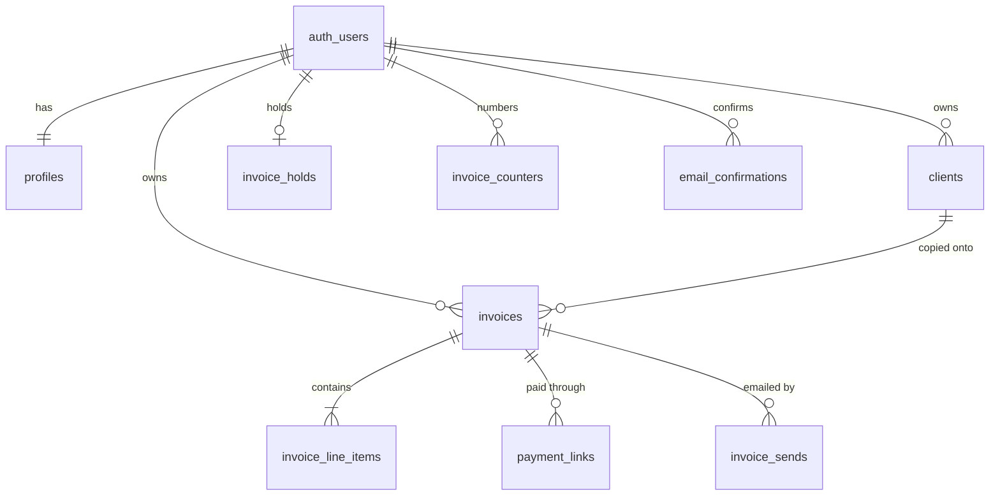

# Invoice Generator — Database schema

Postgres on Supabase. Product rules are in [PRD.md](./PRD.md). How the app uses this schema is in [Tech.md](./Tech.md).

## Conventions

- Identifiers are lowercase `snake_case`.
- Primary keys on application tables are `bigint generated always as identity`. This is one database, so sequential ids stay compact and locality-friendly.
- `profiles.id` is `uuid` because it is `auth.users.id`.
- Money, quantity, and VAT use `numeric`. Timestamps use `timestamptz`. Strings use `text`.
- Status and currency values use `text` plus a check constraint.
- Every table in `public` has Row Level Security enabled. Policies target `authenticated` and compare `(select auth.uid())` so the id is evaluated once per query.
- Foreign keys are indexed.
- A user id on a child row matches the parent through a composite foreign key, so a client or line cannot be attached across users.
- `anon` has no grants on these tables. `authenticated` gets only the actions a policy allows, and on several tables only specific columns. The Stripe webhook uses the secret key as `service_role`, which bypasses RLS and has full table grants.

Overdue is not a column. A list filters it with `status = 'not_paid' and due_date < current_date`.

## Relationships



## Tables

### `profiles`

One row per auth user, created by trigger on sign-up.

| Column | Type | Notes |
|---|---|---|
| `id` | `uuid` pk | References `auth.users(id)` on delete cascade |
| `full_name` | `text` | |
| `company_name` | `text` | Create requires this or `full_name` |
| `email` | `text` | Reply-To when present |
| `address` | `text` | |
| `vat_id` | `text` | |
| `website` | `text` | |
| `email_confirmed_at` | `timestamptz` | Empty until the app confirmation link is used |
| `stripe_account_id` | `text` unique | Connect account id |
| `stripe_charges_enabled` | `boolean` | Default false. Create sends only when true |
| `created_at` | `timestamptz` | |
| `updated_at` | `timestamptz` | |

### `clients`

| Column | Type | Notes |
|---|---|---|
| `id` | `bigint` identity pk | |
| `user_id` | `uuid` | Owner |
| `full_name` | `text` | |
| `company_name` | `text` | |
| `email` | `text` | Required by the app before the client can be invoiced |
| `address` | `text` | |
| `vat_id` | `text` | |
| `archived_at` | `timestamptz` | Empty means active. Archive sets it. Restore clears it |
| `created_at` | `timestamptz` | |
| `updated_at` | `timestamptz` | |

There is no delete policy. The picker reads rows where `archived_at` is null and `email` is not null. Unique `(id, user_id)` supports the composite foreign key from invoices.

### `invoice_counters`

Legacy table from the earlier per-year sequence format (`INV-YYYY-001`). New invoices use `INV-YYYY-MM-DD-{id}` and do not read or write this table. It may still exist in the database until a later cleanup migration removes it and `private.next_invoice_number`.

| Column | Type | Notes |
|---|---|---|
| `user_id` | `uuid` | |
| `year` | `integer` | |
| `last_number` | `integer` | Last allocated sequence value |

Primary key `(user_id, year)`.

### `invoices`

The From and To columns are the copy taken at creation. They are what the PDF and the detail screen render.

| Column | Type | Notes |
|---|---|---|
| `id` | `bigint` identity pk | |
| `user_id` | `uuid` | Owner |
| `client_id` | `bigint` | Source client. Remains set after the client is archived |
| `invoice_number` | `text` | `INV-2026-11-01-00000042`. Immutable |
| `invoice_date` | `date` | |
| `due_date` | `date` | Must be on or after `invoice_date` |
| `currency` | `text` | `EUR`, `USD`, or `GBP` |
| `status` | `text` | `not_paid` or `paid`. Default `not_paid` |
| `paid_via` | `text` | `stripe` or `manual`. Empty while unpaid |
| `paid_at` | `timestamptz` | Empty while unpaid |
| `comments` | `text` | Printed in the footer |
| `from_full_name` | `text` | Snapshot |
| `from_company_name` | `text` | Snapshot. At least one of the two From names is required |
| `from_email` | `text` | Snapshot |
| `from_address` | `text` | Snapshot |
| `from_vat_id` | `text` | Snapshot |
| `from_website` | `text` | Snapshot |
| `to_full_name` | `text` | Snapshot |
| `to_company_name` | `text` | Snapshot |
| `to_email` | `text` | Snapshot. Required |
| `to_address` | `text` | Snapshot |
| `to_vat_id` | `text` | Snapshot |
| `subtotal` | `numeric(12,2)` | Sum of line amounts |
| `tax` | `numeric(12,2)` | Sum of line tax |
| `total` | `numeric(12,2)` | Greater than zero |
| `pdf_path` | `text` | Object path inside the `invoices` bucket |
| `send_status` | `text` | `sent` or `failed` |
| `send_error` | `text` | Last failure message |
| `last_sent_at` | `timestamptz` | |
| `created_at` | `timestamptz` | |
| `updated_at` | `timestamptz` | |

Unique `(user_id, invoice_number)`. Unique `(id, user_id)` for composite children.

Paid rows satisfy `paid_via` in (`stripe`, `manual`) and `paid_at` is set. Unpaid rows have both empty.

### `invoice_line_items`

| Column | Type | Notes |
|---|---|---|
| `id` | `bigint` identity pk | |
| `invoice_id` | `bigint` | |
| `user_id` | `uuid` | Same owner as the invoice |
| `position` | `integer` | Display order, unique per invoice |
| `description` | `text` | Required |
| `quantity` | `numeric(10,2)` | Greater than zero |
| `unit` | `text` | `hours`, `days`, `pieces`, or `flat` |
| `unit_price` | `numeric(12,2)` | Zero or greater |
| `vat_rate` | `numeric(5,2)` | From 0 through 100 |
| `line_subtotal` | `numeric(12,2)` | `round(quantity * unit_price, 2)` |
| `line_tax` | `numeric(12,2)` | `round(line_subtotal * vat_rate / 100, 2)` |
| `line_total` | `numeric(12,2)` | `line_subtotal + line_tax` |

`private.set_line_amounts` runs before insert and update and overwrites the three computed columns. The client cannot store a mismatched line total. After the statement, the parent `subtotal`, `tax`, and `total` are rewritten from the stored lines. An invoice update does the same once any line exists, so a direct edit of those three columns does not stick.

### `payment_links`

An invoice has many historical links and one active link.

| Column | Type | Notes |
|---|---|---|
| `id` | `bigint` identity pk | |
| `invoice_id` | `bigint` | |
| `user_id` | `uuid` | |
| `stripe_checkout_session_id` | `text` unique | |
| `url` | `text` | Client payment URL |
| `amount` | `numeric(12,2)` | Invoice total at the time the link was created |
| `currency` | `text` | |
| `active` | `boolean` | Default true |
| `deactivated_at` | `timestamptz` | |
| `created_at` | `timestamptz` | |

Partial unique index on `invoice_id` where `active`.

### `invoice_sends`

One row per send attempt, including the first send, a retry, and a resend.

| Column | Type | Notes |
|---|---|---|
| `id` | `bigint` identity pk | |
| `invoice_id` | `bigint` | |
| `user_id` | `uuid` | |
| `note` | `text` | Optional personal note for this attempt |
| `status` | `text` | `sent` or `failed` |
| `resend_email_id` | `text` | Present when Resend accepted it |
| `error` | `text` | |
| `created_at` | `timestamptz` | |

### `invoice_holds`

At most one Stripe onboarding intent per user. This is not an invoice and does not consume a number.

| Column | Type | Notes |
|---|---|---|
| `user_id` | `uuid` pk | |
| `payload` | `jsonb` | `{ "intent": "profile" }` or `{ "intent": "send", "invoice_id", "note" }` |
| `created_at` | `timestamptz` | |
| `updated_at` | `timestamptz` | |

The payload is replaced when the user starts Connect again. A profile intent is deleted when onboarding returns. A send intent is deleted after that invoice is emailed. Leaving onboarding early keeps the saved invoice.

### `email_confirmations`

| Column | Type | Notes |
|---|---|---|
| `id` | `bigint` identity pk | |
| `user_id` | `uuid` | |
| `token_hash` | `text` unique | The raw token exists only in the email |
| `expires_at` | `timestamptz` | |
| `used_at` | `timestamptz` | |
| `created_at` | `timestamptz` | |

No policies and no grants for `authenticated`. `public.issue_email_confirmation` stores the hex SHA-256 hash, and `public.confirm_email` consumes it.

### `stripe_events`

| Column | Type | Notes |
|---|---|---|
| `id` | `text` pk | Stripe event id |
| `event_type` | `text` | |
| `received_at` | `timestamptz` | |

No policies and no grants for `authenticated`. The webhook inserts with the secret key. A primary-key conflict means the event was already handled.

## Indexes

- `clients (user_id)` and partial `clients (user_id) where archived_at is null`
- `invoices (user_id, created_at desc)`
- `invoices (user_id, status, due_date)`
- `invoices (client_id, user_id)`
- `invoice_line_items (invoice_id, user_id)` and `invoice_line_items (user_id)`
- `payment_links (invoice_id, user_id)` and `payment_links (user_id)`, plus the partial unique active index
- `invoice_sends (invoice_id, created_at desc)`, `invoice_sends (invoice_id, user_id)`, and `invoice_sends (user_id)`
- `email_confirmations (user_id)`

Composite foreign keys are indexed on the full key, in key order. The extra `user_id` indexes cover the row-level policies. Other foreign-key columns are covered by these indexes or by a primary key.

## Access

| Table | `authenticated` |
|---|---|
| `profiles` | Select its own row. Update only `full_name`, `company_name`, `email`, `address`, `vat_id`, and `website`. Insert is the sign-up trigger |
| `clients` | Select and insert its own rows. Update the client fields, not `id` or `user_id`. No delete |
| `invoices` | Select, update, and delete its own unpaid rows. Insert is `create_invoice` only |
| `invoice_line_items` | Select, insert, and delete its own rows. Update `position`, `description`, `quantity`, `unit`, `unit_price`, and `vat_rate`. A trigger rejects changes while the invoice is paid |
| `payment_links` | Select and insert its own rows. Update `active` and `deactivated_at` |
| `invoice_sends` | Select and insert its own rows |
| `invoice_holds` | Select, insert, and delete its own row. Update `payload` |
| `invoice_counters` | None |
| `email_confirmations` | None |
| `stripe_events` | None |

`authenticated` also has `usage` and `select` on the identity sequences for `clients`, `invoice_line_items`, `payment_links`, and `invoice_sends`. It has no sequence grant for `invoices` or `email_confirmations`, because those inserts go through security-definer functions.

Update policies include both `using` and `with check`, each requiring `(select auth.uid()) = user_id`, so a row cannot be reassigned to another user. On `profiles` the same check uses `id`.

Delete on `invoices` requires `status = 'not_paid'`.

`private.lock_paid_invoice` rejects line changes and invoice content changes when `paid_via = 'stripe'`. A later update of a Stripe-paid row is rejected. The only transition into `paid_via = 'stripe'` is the webhook: `auth.jwt() ->> 'role'` or `current_user` must be `service_role`, `status` must become `paid`, `paid_at` must be set, and every other column except `updated_at` must stay as it was.

When `paid_via = 'manual'`, the only allowed invoice update clears `status`, `paid_via`, and `paid_at` back to unpaid. Line changes are rejected while `paid_via` is set. After that unpay update, line changes are allowed.

`id`, `user_id`, `invoice_number`, `created_at`, and the From snapshot are unchanged by every invoice update. Changing the selected client is an explicit update of `client_id` and the To snapshot together, done by the server action.

A direct delete of a paid invoice is rejected. A delete caused by a cascading foreign key is allowed, so deleting the auth user still removes that user's paid invoices. Account deletion is outside this version. The cascade is there so the foreign keys can do their job.

## Functions and triggers

`private.set_updated_at` runs before update on `profiles`, `clients`, `invoices`, and `invoice_holds`.

`private.handle_new_user` is security definer, `search_path` empty, and is only used as an after-insert trigger on `auth.users`. It inserts `profiles (id)` and leaves an existing profile as it is.

`private.next_invoice_number(p_user_id uuid, p_year integer) returns text` is legacy. It is no longer called by `create_invoice`.

`public.create_invoice(p_client_id bigint, p_invoice_date date, p_due_date date, p_currency text, p_comments text, p_lines jsonb) returns public.invoices` is security definer, `search_path` empty, and `execute` is granted to `authenticated` only. There is no user id argument. `p_lines` is a JSON array of objects with `description`, `quantity`, `unit`, `unit_price`, and `vat_rate`. Position is the 1-based array order. It:

1. Reads the user from `auth.uid()` and stops when there is no signed-in user.
2. Copies the caller's profile and the selected client after checking both belong to that user, the profile has a full name or a company name, and the client email is not blank. The stored To email is trimmed.
3. Raises when the due date is before the invoice date, when there is not at least one line, or when the computed total is not greater than zero.
4. Inserts the invoice with a temporary `invoice_number`, then sets `invoice_number` to `INV-YYYY-MM-DD-{id}` using the invoice date and the new row id, zero-padded to eight digits.
5. Inserts all line items in the same transaction.
6. Lets `private.set_line_amounts` compute each line, then lets the statement trigger set `subtotal`, `tax`, and `total` from those lines.
7. Returns the invoice row. A total that is not greater than zero raises again, and the insert rolls back.

`public.release_failed_invoice(p_invoice_id bigint) returns void` is security definer, `search_path` empty, and `execute` is granted to `authenticated` only. There is no user id argument. It locks the caller's unpaid invoice and deletes that row. A paid invoice, or an invoice owned by someone else, raises. The stored PDF is removed by the server action, not by this function.

`private.note_invoice_for_recalc` runs after each line insert, update, or delete and records the affected invoice. `private.recalculate_noted_invoices` runs after the statement, rewrites each affected invoice's totals from its lines, and drops that record. One statement therefore updates the parent once, after every line in the statement is stored.

`private.lock_paid_invoice` runs before update and delete on invoices, and before insert, update, and delete on lines. It is security invoker with an empty `search_path`. Its payment rules are the ones in the access section above.

`public.issue_email_confirmation(p_token text, p_expires_at timestamptz)` stores `encode(extensions.digest(p_token, 'sha256'), 'hex')` for `auth.uid()`. The token must be non-empty and the expiry must be in the future. Security definer, `search_path` empty, granted to `authenticated` only.

`public.confirm_email(p_token text)` hashes the token the same way, checks the unused unexpired row for `auth.uid()`, sets `used_at`, and sets `profiles.email_confirmed_at` when it is still empty. A second use of the same token raises. Security definer, `search_path` empty, granted to `authenticated` only.

`execute` on the private trigger functions is revoked from `public`, `anon`, `authenticated`, and `service_role`. The `private` schema itself is revoked from `public`, `anon`, and `authenticated`.

## Storage

One private bucket, `invoices`.

Object name: `{user_id}/{year}/{month}/{day}/{invoice_id}/{year}-{month}-{day}_{invoice_id}_{invoice_number}.pdf`.

The invoice id is zero-padded to 8 digits. Year, month, and day are the invoice date, zero-padded. Example: `{user_id}/2026/11/01/00000042/2026-11-01_00000042_INV-2026-11-01-00000042.pdf`. The attachment and download name are the basename. `pdf_path` stores this key. The first folder remains the user id, which is what the storage policies check.

Policies on `storage.objects` let `authenticated` select, insert, update, and delete objects in that bucket whose first path folder equals `(select auth.uid())::text`. The update policy has both `using` and `with check`, so a file cannot be moved into another user's folder. Select, insert, and update together allow replacing a PDF. Delete is allowed for the same folder so removing an unpaid invoice can remove its PDF. The bucket has no public read.

## Schema

```sql
create schema if not exists private;

create table public.profiles (
  id uuid primary key references auth.users (id) on delete cascade,
  full_name text,
  company_name text,
  email text,
  address text,
  vat_id text,
  website text,
  email_confirmed_at timestamptz,
  stripe_account_id text unique,
  stripe_charges_enabled boolean not null default false,
  created_at timestamptz not null default now(),
  updated_at timestamptz not null default now()
);

create table public.clients (
  id bigint generated always as identity primary key,
  user_id uuid not null references auth.users (id) on delete cascade,
  full_name text,
  company_name text,
  email text,
  address text,
  vat_id text,
  archived_at timestamptz,
  created_at timestamptz not null default now(),
  updated_at timestamptz not null default now(),
  unique (id, user_id)
);

create index clients_user_id_idx on public.clients (user_id);
create index clients_active_user_id_idx
  on public.clients (user_id)
  where archived_at is null;

create table public.invoice_counters (
  user_id uuid not null references auth.users (id) on delete cascade,
  year integer not null,
  last_number integer not null,
  primary key (user_id, year),
  constraint invoice_counters_last_number_positive check (last_number > 0)
);

create table public.invoices (
  id bigint generated always as identity primary key,
  user_id uuid not null references auth.users (id) on delete cascade,
  client_id bigint not null,
  invoice_number text not null,
  invoice_date date not null,
  due_date date not null,
  currency text not null,
  status text not null default 'not_paid',
  paid_via text,
  paid_at timestamptz,
  comments text,
  from_full_name text,
  from_company_name text,
  from_email text,
  from_address text,
  from_vat_id text,
  from_website text,
  to_full_name text,
  to_company_name text,
  to_email text not null,
  to_address text,
  to_vat_id text,
  subtotal numeric(12,2) not null,
  tax numeric(12,2) not null,
  total numeric(12,2) not null,
  pdf_path text,
  send_status text,
  send_error text,
  last_sent_at timestamptz,
  created_at timestamptz not null default now(),
  updated_at timestamptz not null default now(),
  unique (user_id, invoice_number),
  unique (id, user_id),
  foreign key (client_id, user_id) references public.clients (id, user_id),
  constraint invoices_currency_known check (currency in ('EUR', 'USD', 'GBP')),
  constraint invoices_status_known check (status in ('not_paid', 'paid')),
  constraint invoices_paid_via_known check (
    paid_via is null or paid_via in ('stripe', 'manual')
  ),
  constraint invoices_send_status_known check (
    send_status is null or send_status in ('sent', 'failed')
  ),
  constraint invoices_due_on_or_after_issue check (due_date >= invoice_date),
  constraint invoices_total_positive check (total > 0),
  constraint invoices_sender_snapshot check (
    char_length(btrim(coalesce(from_full_name, ''))) > 0
    or char_length(btrim(coalesce(from_company_name, ''))) > 0
  ),
  constraint invoices_payment_state check (
    (
      status = 'not_paid'
      and paid_via is null
      and paid_at is null
    )
    or (
      status = 'paid'
      and paid_via in ('stripe', 'manual')
      and paid_at is not null
    )
  )
);

create index invoices_user_created_idx
  on public.invoices (user_id, created_at desc);
create index invoices_user_status_due_idx
  on public.invoices (user_id, status, due_date);
create index invoices_client_id_user_id_idx
  on public.invoices (client_id, user_id);

create table public.invoice_line_items (
  id bigint generated always as identity primary key,
  invoice_id bigint not null,
  user_id uuid not null,
  position integer not null,
  description text not null,
  quantity numeric(10,2) not null,
  unit text not null,
  unit_price numeric(12,2) not null,
  vat_rate numeric(5,2) not null,
  line_subtotal numeric(12,2) not null,
  line_tax numeric(12,2) not null,
  line_total numeric(12,2) not null,
  unique (invoice_id, position),
  foreign key (invoice_id, user_id)
    references public.invoices (id, user_id) on delete cascade,
  constraint invoice_line_items_quantity_positive check (quantity > 0),
  constraint invoice_line_items_price_nonnegative check (unit_price >= 0),
  constraint invoice_line_items_vat_range check (vat_rate >= 0 and vat_rate <= 100),
  constraint invoice_line_items_unit_known check (
    unit in ('hours', 'days', 'pieces', 'flat')
  ),
  constraint invoice_line_items_description_present check (
    char_length(btrim(description)) > 0
  )
);

create index invoice_line_items_invoice_id_user_id_idx
  on public.invoice_line_items (invoice_id, user_id);
create index invoice_line_items_user_id_idx
  on public.invoice_line_items (user_id);

create table public.payment_links (
  id bigint generated always as identity primary key,
  invoice_id bigint not null,
  user_id uuid not null,
  stripe_checkout_session_id text not null unique,
  url text not null,
  amount numeric(12,2) not null,
  currency text not null,
  active boolean not null default true,
  deactivated_at timestamptz,
  created_at timestamptz not null default now(),
  foreign key (invoice_id, user_id)
    references public.invoices (id, user_id) on delete cascade,
  constraint payment_links_currency_known check (currency in ('EUR', 'USD', 'GBP')),
  constraint payment_links_amount_positive check (amount > 0),
  constraint payment_links_active_state check (
    (active and deactivated_at is null)
    or (not active and deactivated_at is not null)
  )
);

create index payment_links_invoice_id_user_id_idx
  on public.payment_links (invoice_id, user_id);
create index payment_links_user_id_idx on public.payment_links (user_id);
create unique index payment_links_one_active_idx
  on public.payment_links (invoice_id)
  where active;

create table public.invoice_sends (
  id bigint generated always as identity primary key,
  invoice_id bigint not null,
  user_id uuid not null,
  note text,
  status text not null,
  resend_email_id text,
  error text,
  created_at timestamptz not null default now(),
  foreign key (invoice_id, user_id)
    references public.invoices (id, user_id) on delete cascade,
  constraint invoice_sends_status_known check (status in ('sent', 'failed'))
);

create index invoice_sends_invoice_id_created_idx
  on public.invoice_sends (invoice_id, created_at desc);
create index invoice_sends_invoice_id_user_id_idx
  on public.invoice_sends (invoice_id, user_id);
create index invoice_sends_user_id_idx on public.invoice_sends (user_id);

create table public.invoice_holds (
  user_id uuid primary key references auth.users (id) on delete cascade,
  payload jsonb not null,
  created_at timestamptz not null default now(),
  updated_at timestamptz not null default now()
);

create table public.email_confirmations (
  id bigint generated always as identity primary key,
  user_id uuid not null references auth.users (id) on delete cascade,
  token_hash text not null unique,
  expires_at timestamptz not null,
  used_at timestamptz,
  created_at timestamptz not null default now()
);

create index email_confirmations_user_id_idx
  on public.email_confirmations (user_id);

create table public.stripe_events (
  id text primary key,
  event_type text not null,
  received_at timestamptz not null default now()
);
```

RLS, column grants, triggers, and the function bodies are applied with the migration that creates these tables. The policies and grants follow the access section above. Invoice insert is revoked from `authenticated`, and `public.create_invoice` is the insert path. `email_confirmed_at` and the Stripe profile columns are not granted to `authenticated`. `confirm_email` and the webhook set them.
