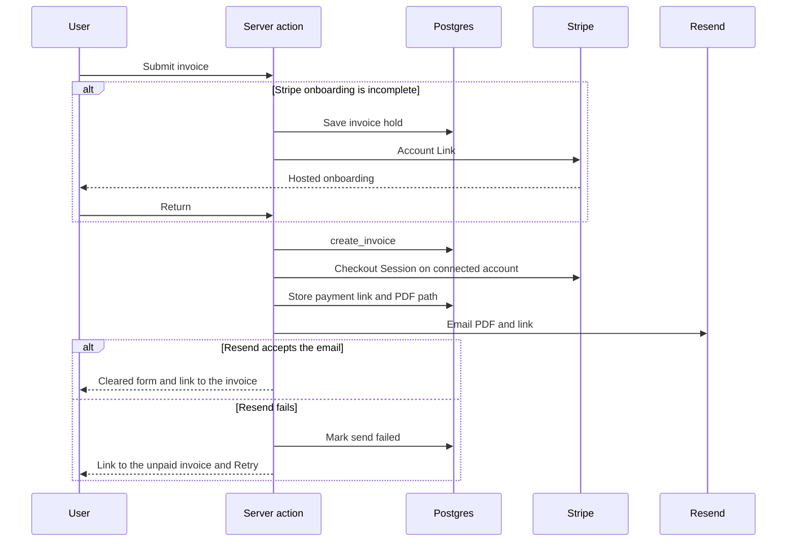

# Invoice Generator — Technical design

This document describes how the product in [PRD.md](./PRD.md) is built. The database shape is in [DB.md](./DB.md).

## Stack

| Layer | Choice | Already in the repo |
|---|---|---|
| App | Next.js 16.4.3 App Router, React 19.3, TypeScript | Yes |
| Auth, database, files | Supabase Auth, Postgres, Storage. Access from the app goes through `@supabase/ssr` 0.12.7 and `@supabase/supabase-js` 2.118 | Yes. Browser, server, and middleware clients exist |
| Email | Resend 6.35, via `utils/email/send.ts` | Yes. `RESEND_API_KEY` and `EMAIL_FROM` |
| UI | Tailwind CSS 4, shadcn 4.23, style `base-nova`, base color `mist`, Lucide, CSS variables | Yes. `components/ui/button.tsx` is the only installed component |
| Payments | Stripe Connect Express and Checkout, server-side `stripe` package | No. Add `stripe` when payments are built |
| PDF | `@react-pdf/renderer`, generated in a server action and stored in Supabase Storage | No. Add it when the PDF is built |
| Forms | shadcn form pieces, plus `react-hook-form` and `zod` | No. Add them with the first form |

The home page still selects a placeholder `todos` table. That query goes away when the invoice list replaces it.

shadcn components are added with the project CLI so they keep the `base-nova` / `mist` preset in `components.json`. The first screens need button (already present), input, textarea, label, form, select, calendar, popover, table, badge, dialog, dropdown-menu, card, alert, sonner, and separator. New primitives come from the registry rather than from hand-written copies.

## Application shape

```
app/
  (auth)/login, register, forgot-password, reset-password
  (app)/invoices                 home list
  (app)/invoices/new             create, preview, send
  (app)/invoices/[id]            detail
  (app)/clients
  (app)/clients/[id]
  (app)/settings                 profile
  auth/confirm                   email confirmation landing
  auth/callback                  Supabase password-recovery callback
  settings/stripe/return         Stripe Account Link return
  settings/stripe/refresh        Stripe Account Link refresh
  api/stripe/webhook             signed Connect webhook
utils/supabase/                  existing browser, server, and middleware clients
utils/email/send.ts              existing Resend helper
lib/invoice/calculate.ts         shared line and invoice math
lib/invoice/format.ts            shared 1,234.56 EUR formatting
lib/invoice/pdf.tsx              PDF document
```

Server Components read data. Mutations run in Server Actions. The browser Supabase client is limited to auth UI state. Stripe secret keys, the Resend key, and the Supabase secret key stay on the server.

`middleware.ts` already refreshes the session with `supabase.auth.getUser()` and copies cookies onto the response. Route protection is added there: signed-out visitors can open the auth screens, and every other page redirects to sign in.

## Auth

Sign-in is email and password through Supabase Auth. Forgot-password uses Supabase `resetPasswordForEmail` and the existing callback route, then a reset screen that calls `updateUser`.

The product allows a session before the address is confirmed, and disables Create until it is confirmed. Supabase's Confirm email setting does the opposite: it withholds the session until the link is opened. That setting stays off, so sign-up returns a session.

Confirmation is then an app concern:

1. A trigger creates an empty `profiles` row when `auth.users` gains a user. `profiles.email_confirmed_at` stays empty.
2. Sign-up and a Resend confirmation action create a one-time token, store only its hash, and send the link with Resend.
3. `/auth/confirm` calls a database function that marks the matching unused, unexpired token as used and sets `profiles.email_confirmed_at`.
4. The create action refuses to run while `email_confirmed_at` is empty. The invoices page shows why, and offers a new confirmation email.

Password reset continues to use Supabase's own mail, because that flow already matches the product.

## Who calls the database

The signed-in user reads and updates their own rows through Row Level Security. The publishable key is the key already used by the Supabase clients.

Two operations need a privileged path:

- Creating an invoice, because the invoice number has to be allocated without letting the browser pick it.
- The Stripe webhook, because it has no user session. It uses `SUPABASE_SECRET_KEY` on the server only.

Every other write uses the user session. The secret key is never referenced from a client component or a `NEXT_PUBLIC_` variable.

## Create, hold, and send

Create is one server action.

1. Load the user and the profile. Stop when the email is unconfirmed, or when both sender names are empty.
2. Validate the payload with zod: client belongs to the user, client has an email, dates, currency, at least one line, and a total above zero. Totals are computed in `lib/invoice/calculate.ts`. The same function is used by the live preview and the PDF, so the three never disagree.
3. Load the connected account. When `stripe_charges_enabled` is false, upsert `invoice_holds` for this user with the form payload, create a Stripe Account Link, and redirect to it. The hold is not an invoice and has no number.
4. On return, the return route checks the account. When charges are enabled, it runs this same action with the stored hold and then deletes the hold. Leaving onboarding early leaves the hold unused. The next submit replaces it.
5. Call `create_invoice`. That function, in one transaction, locks the user's counter for the invoice-date year, assigns `INV-YYYY-001`, copies From and To, and inserts the lines. It stores the computed subtotal, tax, and total. A rolled-back failure gives the number back.
6. Create a Checkout Session on the connected account (see Stripe below) and insert the active `payment_links` row.
7. Render the PDF, upload it to the private `invoices` bucket at `{user_id}/{invoice_id}.pdf`, and store that path.
8. Send the email with the existing Resend helper. The attachment is the PDF. `replyTo` is the profile email, or the account email when the profile email is empty. Record the attempt in `invoice_sends`.
9. On Resend success, set the invoice send state to sent. On failure, set it to failed, keep the invoice and the payment link, and return the invoice id so the form can show Send failed and a link to the invoice.

The form clears only after a successful send. A second click cannot create another invoice. If step 6 or 7 fails after the row exists, the action deletes that unpaid invoice, which returns its number only when the delete runs in a compensating transaction that also decrements the counter. The user sees an error and can submit again. An email failure does not delete the invoice.

From and To copies are taken inside `create_invoice`, after onboarding returns, so they match the profile and client at send time.

## Edit, resend, status, delete

Edits of an unpaid invoice recompute totals in the server action and update the invoice and its lines. `invoice_number` is immutable in the database.

The action then:

- expires the Stripe Checkout Session and deactivates its `payment_links` row when the total, currency, or client changed, and creates a new session
- leaves the active link in place when only the dates or comments changed
- regenerates and replaces the stored PDF in both cases
- returns to the page, which opens the resend dialog

The dialog posts the optional note. Declining a resend leaves the new PDF stored and does not send mail. Accepting a resend writes another `invoice_sends` row.

Mark paid by hand expires the session, deactivates the link, and sets `status = paid`, `paid_via = manual`. Set back to unpaid clears those fields and creates a new session. It does not send mail.

Delete is offered for unpaid invoices. The action expires the session, then deletes the row. Line items, links, and send rows go with it. The PDF object is removed from Storage.

A Stripe-paid invoice cannot take any of these paths. The database trigger is the backstop. The webhook is the only writer that moves `paid_via` to `stripe`.

## Stripe

The platform has one Stripe account. Each freelancer has a Connect Express account. The user completes Stripe-hosted onboarding through an Account Link. Return and refresh URLs land on the app routes above. The refresh route issues a new Account Link when the previous one has expired.

Charges are direct charges on the connected account:

- Checkout Session is created with the Stripe-Account header set to `profiles.stripe_account_id`
- `application_fee_amount` is omitted
- one Session exists per active link, for the invoice total in EUR, USD, or GBP
- `mode` is `payment`
- automatic payment methods stay on, so the client sees the methods that connected account can accept
- metadata carries the invoice id
- success and cancel URLs bring the client back to a simple paid or cancelled page that does not require an app account

The webhook is a Connect webhook on the platform. The route reads the raw body and verifies `STRIPE_WEBHOOK_SECRET` before any other work.

Handled events:

| Event | Result |
|---|---|
| `checkout.session.completed` with `payment_status = paid` | Invoice becomes paid via Stripe, link deactivated |
| `checkout.session.async_payment_succeeded` | Same, for methods that settle later |
| `checkout.session.async_payment_failed` | Invoice stays unpaid, link stays active |
| `account.updated` | Refresh `stripe_charges_enabled` for that account |

The event id is inserted into `stripe_events` first. A duplicate id stops the handler, so a retried webhook cannot mark an invoice twice. The handler uses the secret key.

Marking an invoice paid, replacing a link, or deleting an invoice calls `checkout.sessions.expire` on that connected account before the database change.

## Email

`sendEmail` already sends through Resend from `EMAIL_FROM`, with HTML, text, reply-to, and attachments. Invoice mail uses that function. The subject and body are the fixed copy in the PRD. The personal note is inserted only when the user submitted one, and it is treated as text.

Confirmation mail and the invoice mail are the two Resend messages. Supabase sends the password reset.

## PDF and preview

The preview is a React component styled with the installed shadcn theme. The PDF is a separate `@react-pdf/renderer` document, because a server action cannot print the browser preview. Both import `calculate` and `format`, and both render the sections listed in the PRD: title, From, To, meta, lines, totals, comments.

`format` always produces `1,234.56 EUR`. Dates are shown as `31 Oct 2026`. The page size is A4. Empty snapshot fields are skipped.

The file is uploaded with the user session to a private bucket. Download creates a short-lived signed URL for that user's object, or streams the object through a route that checks the invoice owner. The bucket is not public.

## UI behavior

The invoice list is a shadcn table with search, a status filter, and pagination of 20 rows. Overdue is computed in the query: unpaid and `due_date < current_date`. It is not stored.

The create form uses shadcn form validation. The preview updates from the form values. Inline client creation is a dialog that inserts a client, then selects it.

After a successful send the form resets and a toast links to the new invoice. Send failed keeps a link to the saved invoice and a retry action.

## Environment

| Variable | Where |
|---|---|
| `NEXT_PUBLIC_SUPABASE_URL` | Already read by the Supabase clients |
| `NEXT_PUBLIC_SUPABASE_PUBLISHABLE_KEY` | Already read by the Supabase clients |
| `SUPABASE_SECRET_KEY` | Server only. Webhook and other sessionless writes |
| `RESEND_API_KEY` | Already read by `utils/email/send.ts` |
| `EMAIL_FROM` | Already read by `utils/email/send.ts` |
| `NEXT_PUBLIC_APP_URL` | Links in email, Stripe return URLs |
| `STRIPE_SECRET_KEY` | Server only |
| `STRIPE_WEBHOOK_SECRET` | Webhook route only |

## Request path


